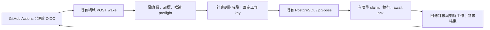

# B05-EW2：Autoscale 外部喚醒實作與切換

狀態：EW2 實作與驗收中，2026-10-17；正式啟用尚未完成。下方 EW1 是保留的原設計，不是目前實作收據。

## 本輪授權與契約

使用者要求「照 SPEC 繼續實作外部喚醒…驗收和切換完成」，授權本 repo/default branch 的有限 OIDC workflow、既有網域 Autoscale 發布與單一執行路徑接手。既有兩份新增 SQL 不重跑，teacher migration 維持 HOLD；不增加任意 DDL、新付費服務或把既有秘密複製到 GitHub。發布時 DB copy 必須 0，資料庫身份及既有表資料前後獨立核對。

- `server/autoscale-app.ts` 是顯式同址部署入口；一般 web boot 不啟 SQL、cron、worker。接收器先 canary，再 active；`NOTIFICATION_WAKE_NOT_BEFORE` 固定首次啟用界線，不能每次重啟往後推。
- `.github/workflows/notification-wake.yml` 在 default `main` 執行；不 checkout、不讀 contents、不用長效秘密。唯一新增權限 `id-token: write`，固定目的地／repo ID／owner ID／ref／workflow／event／audience／簽章及生命期。repository variable `NOTIFICATION_WAKE_ENABLED=true` 另行啟用；default branch workflow-only 更新與 app release 分開驗。
- 每次有效 request 有 20 秒 scope，16.5 秒開始取消，保留 owned DB／report child 回收時間；先 drain、有限 planning、再 drain，最多 100 單位。沒有回應後必要背景工作；driver 最多 10 分鐘／60 請求／8 次錯誤重試，incomplete 留原工作給下一 tick。GitHub 排程仍非準點 SLA。
- 專屬 native PG 保留 provider 設定，但安全 nonce／timeout 不可被 URI query 覆蓋。claim/ACK 保留 wire timestamptz 微秒，成功續段不耗錯誤 retry；apply/checkpoint/ACK 同交易，失敗 ACK 也受原 claim fence。中斷取消只針對 own PID＋nonce＋role＋DB；無法證明 own backend 消失時，明確回 `WAKE_BACKEND_QUIESCENCE_UNVERIFIED`，不宣稱已停。
- 固定 Taipei daily19／weekly Sunday12／Ragic03 到期日期；不建立已過期時段。持久 heartbeat 保存 gap 與 legacy rescue cursor，遺漏窗口持續顯示，不以新 heartbeat 抹除、不自動補送歷史。先處理舊工作，避免 planning 餓死 recipient。
- 只使用既批 queue 名稱；`notification-reconcile` 明確承載 typed `ragic-sync`／`wake-heartbeat`，不挪用 cleanup。canary 僅 schema/queue/receipt，無 business enqueue、expire 或外送；active 不啟 timekeeper／supervisor，顯式 expire，普通啟動仍無 SQL。
- 400 recipient 分段 fanout 25、每 job 一人，沿原 identity/key/body/retry deadline；daily 保存 frozen plan、建立前再查過期。manual 先驗 fresh external receipt，回 202 queued；archived failed recovery 回明確 409，不能假排入成功。
- Ragic 三份來源全部抓完才 apply，每次一筆＋checkpoint；同名 fail closed、只補缺欄、不刪既存。來源回滿 500 筆時拒絕不完整快照並顯示失敗；本輪正式只讀觀察為 31／435／435（當時點），並非無限資料容量承諾。
- 報表採 owned subprocess 呼叫既有 Object Storage SDK，abort/deadline 必須 await child close；scoped mode 無 tmp fallback。報表穩定 key、正式 storage 合成內容寫入／獨立程序讀回另列收據，不等於真 LINE 發送驗收。
- IT 治理顯示 intake、最近 wake、backlog／failed／unknown／missed／Ragic；readiness 專屬 readonly native session。有界 API 只回計數／靜態錯誤，不回來源名單／JWT／秘密；未驗證 wake 不做 app_log DB 寫入，平台僅記靜態 code。

## 驗收與回退 gate

沿用 EW-01～EW-12；local unit／真隔離 PG／source+compiled完整 HTTP／真 GitHub OIDC／正式發布／正式 oracle 分開收據。禁止用舊 258/PG30 或 HTTP200 代替本版驗收。真 LINE 試送不在範圍；400 人測試使用合成 HTTP fixture，正式只看未到期自然流程與 durable receipt。

回退先關 repository variable／receiver，確認 in-flight owner；保留 job、recipient、key、payload、歷史，不回啟舊 unsafe entry、不清庫。正式 canary 未通過前不啟 active。實測／review blockers 未清前不得勾選 B05。

---

# B05-EW1：保留 Autoscale 的外部喚醒設計

狀態：SPEC／待實作與啟用驗收，2026-10-17。使用者已選擇保留現址與 Autoscale；不取消發布、不改常駐 VM。既有 `notification-app.ts` 的隔離驗收不代表本方案已完成。

## 使命、邊界與完成條件

使命：外部服務送入可驗證的喚醒請求，在 HTTP 請求存續期間處理有限量持久工作；無請求時允許 Autoscale 停止，下一次喚醒接續。既有課表、人員與通知身份不回填、不刪除。

DONE WHEN：EW-01～EW-12 全部有同版本實跑證據；正式切換、外部排程啟用、舊 writer 停止與資料保護 oracle 均完成。現在僅設計完成，B05 保持未勾選。

GUARDRAILS：不把 Replit MCP token、管理員密碼、DB 或 LINE 憑證複製到 GitHub；不接受任意命令、收件人或歷史重送參數。不為喚醒開放完整 MCP。不以 HTTP 200、排入成功或 GitHub 綠燈代替通知結果。不自動修改 schema 或啟用 report cleanup；教師 migration HOLD。

## 決策與依據

- Replit 官方說明 Autoscale 閒置可縮到零；因此工作不能依賴回應後的背景 timer。現場「改部署類型」會要求先 Unpublish，已取消操作。此方案保留既有發布實例、網域與資料庫設定。
- 優先評估現有 GitHub repository 的 Actions 作外部喚醒來源。它不是準點服務：官方文件列出排程可能延遲／丟棄、只在 default branch 觸發、公有 repo 閒置 60 天可停用。不得宣稱每五分鐘必定執行，也不採自動產生空 commit 的方式掩蓋停用。
- 採短效 GitHub OIDC 身份候選，避免搬運既有長效秘密。新增信任與 `id-token: write` 仍是待明確批准的權限變更；此 SPEC 不授權啟用。
- 安裝版本 pg-boss 10.4.2 的 timekeeper 只接受最近小於 60 秒的 cron 時點。因此五分鐘喚醒不能只呼叫 `startBoss()` 再等 cron，必須按明確邏輯日期建立到期工作。

## 外部來源與身份契約

候選是 `DAOS-Sport/Co-teaching` 的獨立 workflow；default branch 以現場查詢為準，目前為 `main`。不用拉取 application code，workflow 只取得短效 token 並呼叫固定 HTTPS 端點。準備檔放在 `docs/examples/`，不是 `.github/workflows/`，故不會自行觸發。

服務端只允許 `POST /api/internal/notification-wake`，body 僅 `{ "version": 1 }`。預設旗標關閉；其他 body 欄位拒絕。認證完成前不能建立 DB pool、claim job 或送外部通知。

OIDC 驗證必須包括簽章／受限演算法、可信 JWKS、issuer、精確 audience、exp/nbf/iat、repository/owner 的不可變 ID、ref、workflow 路徑及 event 類型。採專用 environment 時再驗其 claim 與分支限制。不得只 decode JWT、只看 repo 名字或相信客戶端時鐘；GitHub 的新舊 `sub` 格式要從真 token 核定，不能猜格式放寬。

允許來源限此 repo 的已審 workflow、default branch、`schedule`／受控 `workflow_dispatch`；拒絕 fork、PR、其他 ref/repo、錯 audience、過期或未簽 token。JWKS 取得須有 deadline、固定官方目的地、有限 cache／輪替重取；驗證失敗 fail closed。token、JWT、請求 Authorization 不進 log。

短效 token 重播不能產生新業務身份：同一邏輯時段、run、recipient 仍使用既有固定 key。這是副作用去重，不宣稱建立了跨 instance 的一次性 JWT ledger。

## 到期時段與持久身份

時區固定 `Asia/Taipei`，使用服務端可信時鐘。外部 request 不提供日期／名單／排程時刻。pure core 回傳意圖與 key，adapter 才寫 DB。

| 意圖 | 邏輯時段 | 執行要求 |
| --- | --- | --- |
| Weekly | 週日 12:00、目標下一週 | 固定 `weekStartDate/weekEndDate`；沿用 durable run key；整窗 legacy log 拒絕；有課同名帳號拒絕 |
| Daily | 每日 19:00、目標次日 | 把 targetDate 存入工作；重試不能重新用 `Date.now()` 改成另一個「明天」 |
| Reconcile | 每次有效 wake | 只接續既有 run/recipient/key/payload；超出 LINE retry 窗的 unknown 不造新身份 |
| Ragic | 既有每日 03:00 | 需要另一個有完成狀態與中斷恢復的執行契約，見下節；不能默默消失 |

以穩定 UUID／job key 加上 DB unique constraint 建立工作，包含同一 transaction 的 run/recipient/job。到期掃描必須能容忍喚醒延遲與重複，不能單靠記憶體 lastTick。job 與 archive 的保存期、唯一 key 與時段關閉要一起驗，避免 archive 清除後復活同一舊時段。

過期補送政策尚待驗收核定：候選限制 daily 為其邏輯發送日、weekly 為目標週開始之前；超期記 missed／需人工核對，不能用任意 lookback 補發歷史。既有已保存且可安全重試的 recipient 依原重試契約處理，與「新建舊時段」分開。

## 每次請求的有限執行

1. 驗 OIDC、明確旗標、冷設定與 readonly schema；使用專用 PG connection 的 advisory lock 防多 instance 同時規劃，拿不到鎖回 busy，不回 completed。
2. 計算仍有效的 due slots，按固定身份交易 enqueue；不啟動 pg-boss timekeeper。worker 與普通 web lifecycle 分開，不能把 normal boot 改回有 SQL。
3. 使用 `schedule:false`、`supervise:false` 的 bounded queue adapter。每輪明確 `await expire()` 回收已到期 active；單靠 supervisor interval 會在短請求裡永遠來不及回收。
4. Weekly 父工作只保存／fan out 既有 recipient jobs；daily 改成 enqueue-only 並保存 targetDate。每個 recipient 是有限執行單位，保留 claim/fence/key/payload。不得在一個不可中止 handler 內送整份名單。
5. `fetch → handler → await complete/fail`，核對 ack 的 affected result。安裝版 `fetch()` 會吞 SQL 錯誤直接回 `[]`，並不 emit；adapter 必須在 `executeSql` 層保留錯誤並在 fetch 邊界重拋，不能依賴 error event 或把 DB 故障當 drained。也不能依賴目前 `work()` callback 內未 await 的 ack。
6. 在剩餘 budget 不足時停止 claim，await 既有操作及 ack、釋放鎖，再回應。LINE、DB、JWKS、報表／儲存都須有各自的 timeout／AbortSignal；回應後不留下必要背景工作。HTTP 中斷也走 finally，不使用全程序 `process.exit()` 關閉共用網頁。
7. 外部 driver 只在 `remainingWork` 時以同一目的繼續喚醒，受整體 deadline／重試上限限制。達上限記 incomplete／逾時，留原 job 給後續 tick；不清除資料或重建 key。

初始工程候選：每個 HTTP request 20 秒 budget、有限 concurrency、每次只 claim 小批工作、driver 最多 10 分鐘；**這些不是已驗證平台上限或通知 SLA**。實際冷啟、最壞 LINE timeout、400 人員、報表與 Ragic 時長必須先量測，再固定容量及 budget。不能將 20 秒 timer 當已能取消所有底層 await。

現有報表是同步 render／外部儲存流程，Ragic 是多次外部 fetch 加資料套用；尚無本方案的安全 chunk/checkpoint 實證。它們是切換 gate：若不能在驗證過的請求界線完成，就要先補可恢復切片，或另提執行來源；不能悄悄把它們留到 HTTP 回應後。

## Ragic 與管理頁不能遺失的行為

既有 Ragic 03:00、worker report、manual enqueue／retry 都要列入接手矩陣。不能為完成通知切換直接拔掉 Ragic，也不能用每五分鐘 ping 等待舊 node-cron 碰巧存活到 03:00。

若 Ragic 需要專用 queue／partition 或新增 checkpoint 結構，要先列精確 DDL 與回退、隔離演練、取得追加批准。原批准的 9 個 queue 分區不是任意新結構許可。不得挪用 `notification-cleanup` 名稱塞入 Ragic 工作以逃避批准。sync busy／DB lock error 不能視為本日同步成功。

普通 web 不會常駐 worker，所以既有 `areWeeklyPushWorkersReady()` 的 same-process 判斷不能直接沿用為外部模式 readiness。應分別呈現「可持久排入」「最近一次 wake／結果」「目前 backlog／unknown／missed」；管理員按送出得到 queued 收據，不顯示已發送成功。外部 executor 尚未驗好時，wet manual 仍明確拒絕，dry run 保留。

## 啟用、資料保護與回退

順序：獨立 reviewer 核本 SPEC → isolated RED／實作／PG／source+compiled+HTTP 中斷與重啟 → 合成無外送 OIDC dry mode → 取得新增信任／workflow 啟用與必要費用授權 → 審核 default-branch workflow 合併及現址部署 → 確認舊 manual/cron writer 全停止、in-flight 結束 → 啟用單一新路徑 → 正式只讀 oracle 與實際 queue 執行驗收。

正式發布時「Copy your development database to production database」必須保持未勾；不取消發布、不建立替代 DB、不執行啟動 repair。喚醒或排程註冊不能當作正式驗收的附帶效果。

回退先停外部來源與 receiver flag、等待 in-flight，保存所有 job/recipient/key/history；不啟動舊 unsafe boot。只有未發生新活動且具 quiescence 證據時才考慮已審 app-only schema rollback。已送或 unknown 不能透過清空資料還原成未送。

## 驗收矩陣

| AC | 必要證據 |
| --- | --- |
| EW-01 | 同址／Autoscale、正常 S0，冷開 web 無 SQL；原 DB copy flag 未勾 |
| EW-02 | 真 OIDC 簽章／claims；錯 repo/ref/workflow/aud/exp/fork/PR 全拒絕且 0 DB/LINE |
| EW-03 | 12:00／19:00／Taipei 日期邊界、延遲超 60 秒／5 分鐘、跨午夜與過期時段 |
| EW-04 | 並行／重播 wake 只一份 run/recipient/job；交易失敗一起回滾；原歷史指紋一致 |
| EW-05 | 400 人員分批、超時／abort 停止 claim；HTTP 回應前所有必要 ack 已完成 |
| EW-06 | fetch SQL 錯誤不假 drained；ack 失敗回 incomplete；active timeout 下一次明確 expire 可恢復 |
| EW-07 | 平台接受後中斷仍沿原 key/payload；24h 外 unknown 不新身份重送 |
| EW-08 | preview 0 recipient/group/watchdog；weekly legacy／同名仍 fail closed |
| EW-09 | manual queued／executor freshness／結果／backlog 分列，不依常駐本機布林假成功 |
| EW-10 | report 與 Ragic 03:00 有可恢復實證；busy／lock error 不算完成；追加 DDL 另批 |
| EW-11 | 外部 miss、workflow 停用、長期 backlog 可觀察；無外部呼叫時不依背景 timer 完成 |
| EW-12 | 原生正式 transport、單一 owner/in-flight 停止、正式前後資料 oracle、回退及清理 |

目前 EW-01～EW-12 的本方案動態驗收均 NOT_RUN；既有 d9f1114 的 258／PG30 和 bounded 無關的 always-on 入口證據只可按原範圍引用。

## 權限、成本與待啟用條件

要批准的具體新增範圍是：此 repo／default branch／專用 workflow 的 `id-token: write`，Replit wake receiver 僅信任該 OIDC 身份、僅能觸發固定工作；若用 protected environment，另列其限制。不得授予 MCP 命令、任意 DB SQL、通用 GitHub 寫入或 LINE 任意內容能力。

GitHub workflow 尚未放入可執行位置，身份信任／環境／排程未建立。正式啟用還需要 default-branch 合併的對應批准；現有 PR13 目標不是 default branch，不能以它已 push 推定 schedule 生效。

候選每五分鐘約 288 次／日、30 日約 8,640 次喚醒；這只是頻率計算，不是可保證的執行數或費用。既有 Autoscale 會增加 served requests／計算用量；冷啟、每輪時長與 runner 條件／實際價格未量測，費用 UNKNOWN，不宣稱免費。不新增 VM／第三方帳戶或付費排程服務。

## 來源與版本

查閱日期：2026-10-17。官方文件支持平台／身份能力，不能代替本 app 的真 runtime 驗收。

- [Replit 部署類型](https://docs.replit.com/features/publishing/deployment-types)：Autoscale 可縮到零；背景與 Scheduled 為不同部署生命週期。
- [GitHub schedule 事件](https://docs.github.com/en/actions/reference/workflows-and-actions/events-that-trigger-workflows#schedule)：五分鐘最短間隔、default branch、延遲／丟棄及閒置停用限制。
- [GitHub OIDC reference](https://docs.github.com/en/actions/reference/security/oidc)：claims、短效身份及 workflow 權限。真 claim 格式仍須驗。
- 本機安裝 `pg-boss@10.4.2`：`src/timekeeper.js:154-163`、`src/manager.js:435-458`、`:202-232`、`src/boss.js:40-42,115-120,163-165` 與 `types.d.ts:365-366`。
- 實作基線：`d9f11147954febeea23500892d2cece45bcd77b9` 的 `weeklyPush.worker/service/routes`、`line-notify.ts`、`ragic.ts`；不以此設計回寫成既有行為。
